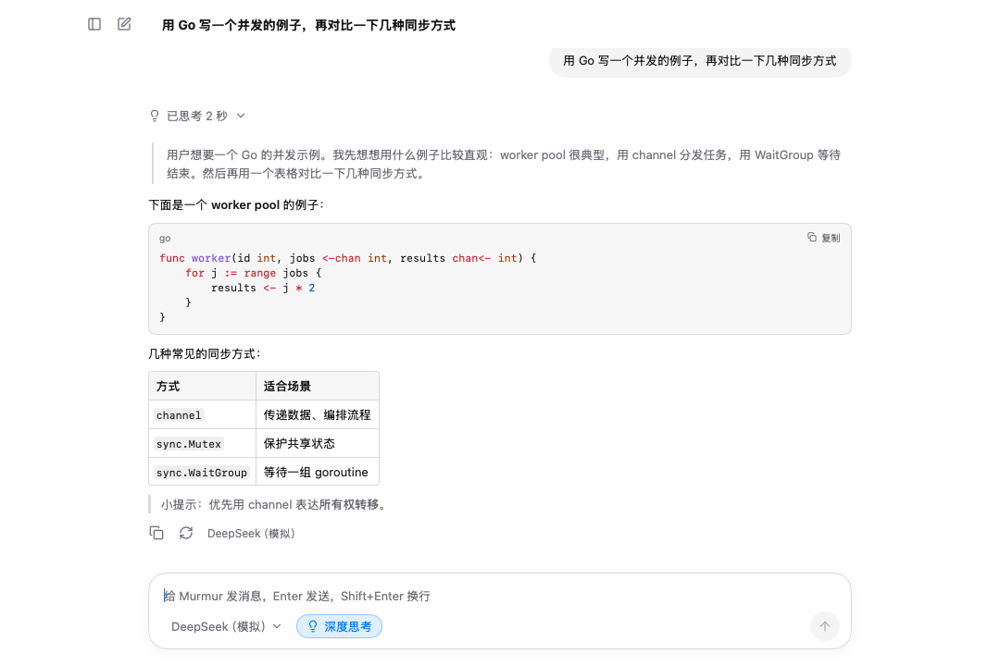

# Murmur

**用你自己的 API Key，在桌面上和各家大模型聊天。** 极简、原生、数据只留在本机。

DeepSeek、通义千问、Kimi、智谱 GLM、豆包、硅基流动、Claude、GPT、Gemini、OpenRouter、本地 Ollama 开箱即选；其他兼容 OpenAI 或 Anthropic 接口的服务也能接。

**[下载最新版](https://github.com/Qsnh/Murmur/releases/latest)** · macOS 12+ · Windows 10 / 11 · 安装包不到 10 MB

## 适合你吗

| | |
|---|---|
| 系统 | macOS 12 及以上（Intel / Apple 芯片），Windows 10 / 11（x64 / ARM） |
| 模型 | 需要你自己的 API Key，或本机跑的 Ollama 等模型。Murmur 不提供模型 |
| 账号 | 不用注册、不用登录 |
| 隐私 | 对话和设置只存在本机；请求直接发到你填的接口地址，不经过中转，没有统计上报 |
| 界面语言 | 中文 |

**能做的**

- 添加任意多个模型，在输入框下方随时切换
- 深度思考一键开关，实时看到模型的思考过程和用时
- 发送图片：点输入框左下角的图片按钮选择，把图片拖进对话区，或直接粘贴截图；一条消息最多 10 张，可以只发图片。需要模型支持识图
- 回复实时渲染 Markdown：代码高亮（可一键复制）、表格、数学公式
- 对话自动保存，按今天 / 昨天 / 7 天内 / 更早分组；复制回复、重新生成、随时停止
- 系统提示词，网络代理（http / https / socks5）
- 原生界面，启动快；外观可选浅色、深色或跟随系统（设置 → 通用 → 外观）

**暂不支持**

- 发送图片以外的文件（PDF、文档等）
- 联网搜索、插件、MCP 等工具调用
- 编辑已发送的消息
- 搜索、重命名、导出对话，多设备同步
- Linux、手机

## 下载安装

到 [Releases](https://github.com/Qsnh/Murmur/releases/latest) 下载对应的文件：

| 你的电脑 | 下载这个 |
|---|---|
| Mac（Intel 和 Apple 芯片通用） | `Murmur-<版本>-macos-universal.dmg` |
| 大多数 Windows 电脑 | `Murmur-Setup-<版本>-windows-amd64.exe` |
| ARM 处理器的 Windows（如骁龙笔记本） | `Murmur-Setup-<版本>-windows-arm64.exe` |
| Windows 免安装版 | `Murmur-<版本>-windows-{amd64,arm64}-portable.zip`，解压后运行 `Murmur.exe` |

安装包还没有开发者签名，第一次打开时系统会拦一下：

- **macOS**：提示无法打开时，到「系统设置 → 隐私与安全性」，在页面下方点「仍要打开」。如果提示「已损坏」，在终端执行 `xattr -dr com.apple.quarantine /Applications/Murmur.app` 后再打开
- **Windows**：SmartScreen 弹窗里点「更多信息」→「仍要运行」

## 三步开始

1. 打开 Murmur，点「添加模型」，选一个服务商，比如 DeepSeek
2. 填入 API Key，点「测试连接」，看到「连接成功」就可以了（Ollama 等本地模型不用填 Key）
3. 回到对话框输入问题，Enter 发送

服务商不在列表里？选「自定义」，填上接口地址和模型 ID。

## 快捷键

| 操作 | macOS | Windows |
|---|---|---|
| 发送 | Enter | Enter |
| 换行 | Shift+Enter | Shift+Enter |
| 新对话 | ⌘N | Ctrl+N |
| 设置 | ⌘, | Ctrl+, |

## 常见问题

**数据和 API Key 存在哪？**

只存在本机，文件仅当前用户可读：

- macOS：`~/Library/Application Support/Murmur/`
- Windows：`%AppData%\Murmur\`

`settings.json` 是模型和设置（API Key 以明文保存在这里），`chats.json` 是全部对话，`images/` 是对话里发送的图片（删除对话时一起删除）。删掉这个文件夹就清空了所有对话和设置。

**发了图片，模型却说看不到，或者报错？**

模型本身要支持识图，比如 GPT-5、Claude、Gemini、通义千问 VL、GLM-4.5V、豆包视觉模型，以及 Ollama 里的 qwen2.5vl、llama3.2-vision 等。DeepSeek、Kimi K2 等纯文本模型不能看图，接口会报错，换一个支持识图的模型再「重新生成」即可。

超过 2048 像素的大图会先缩小再发送，手机照片会按拍摄方向摆正；支持 PNG、JPEG、GIF、WebP、BMP；暂不支持 HEIC，请先转换为 JPEG。

**连不上或者报错？**

在「设置 → 模型」里点「测试连接」，会显示具体的错误。先检查接口地址、API Key 和模型 ID；需要代理才能访问的服务，在「设置 → 通用 → 网络代理」里填上代理地址。

**打开了深度思考，却看不到思考过程？**

首先模型本身要支持思考。各家打开思考的参数不一样，Murmur 默认按接口地址自动识别；识别不对时，在「设置 → 模型 → 思考参数」里手动选：

| 思考参数 | 适用于 |
|---|---|
| `reasoning_effort` | OpenAI、Ollama、Gemini |
| `enable_thinking` | 通义千问、硅基流动 |
| `thinking.type` | 智谱 GLM、DeepSeek、豆包 |
| `reasoning` | OpenRouter |
| 不发送 | Kimi K2 Thinking、DeepSeek Reasoner 等总会思考的模型 |

Anthropic 协议的模型不用选，Murmur 会自动处理。

## 开发

想自己编译或参与开发，见[开发文档](docs/development.md)。
